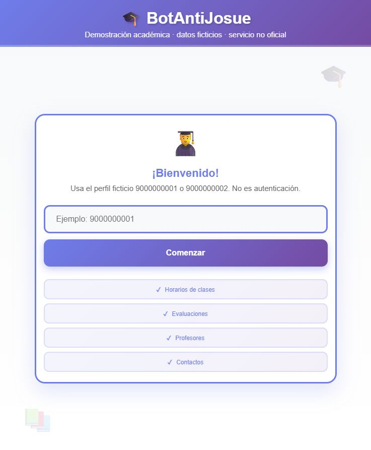
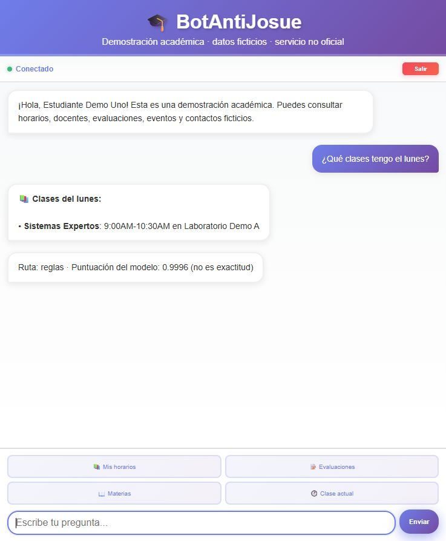
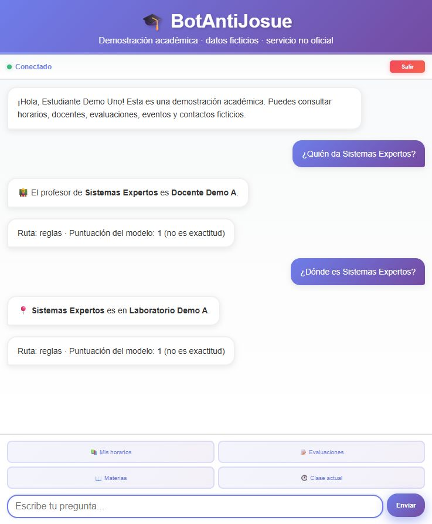
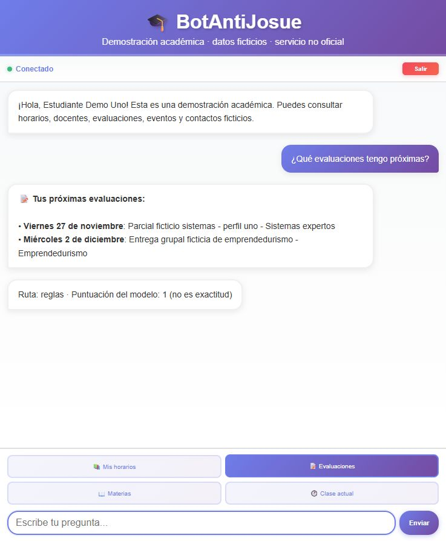
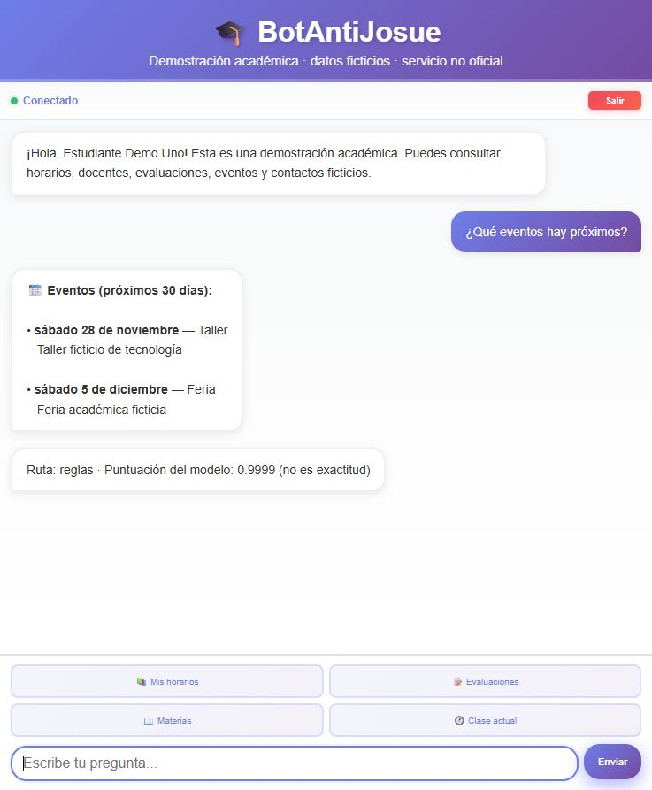
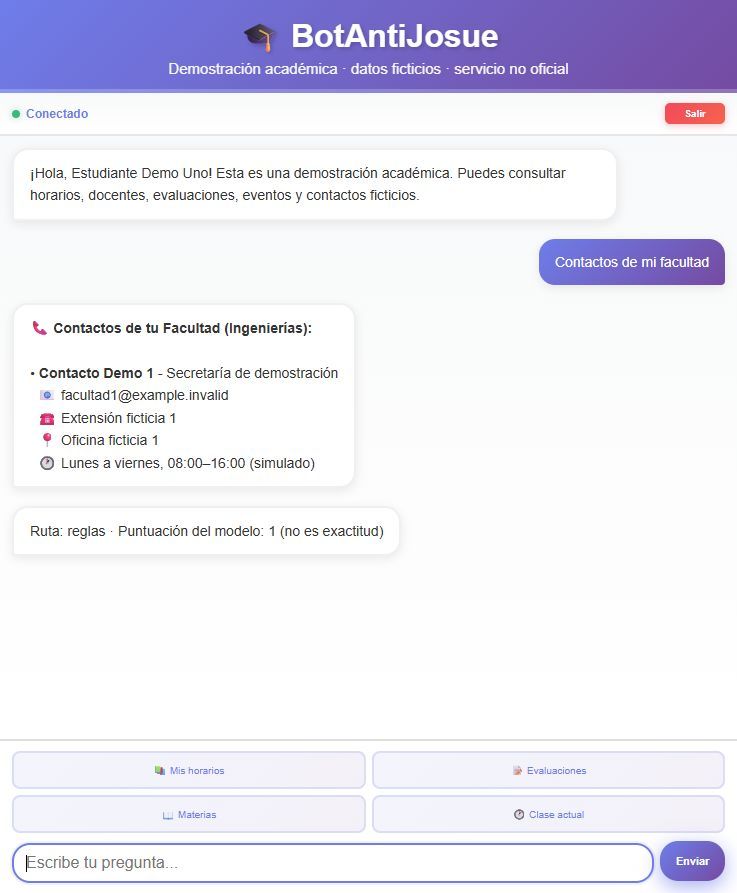
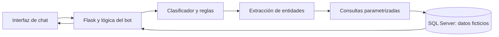

# Caso de estudio: asistente académico

**Python · Flask · TensorFlow/Keras · SQL Server · Docker**

En este proyecto exploré cómo consultar información académica mediante preguntas escritas: horarios, docentes, aulas, evaluaciones, eventos y contactos de facultades. Lo desarrollamos en grupo para la materia de Sistemas Expertos, en el ciclo 8 de 2025. El prototipo se llamó **Bot Antijosué**.

Aquí presento su funcionamiento, arquitectura, aprendizajes y pruebas mediante una demostración local con datos ficticios. La implementación se conserva en un repositorio privado; este caso se puede revisar sin iniciar sesión en la aplicación ni acceder al código.

> **Proyecto académico independiente.** No es un servicio oficial de la universidad ni consulta sus sistemas reales. Las personas, identificadores y contactos que aparecen en las capturas son ficticios.

## Problema y objetivo

Una consulta como «¿qué clase tengo el lunes?» necesita relacionar al estudiante con sus materias, horarios y aulas. Otras preguntas requieren identificar una materia, una facultad o una fecha. El objetivo del prototipo fue reunir esas consultas en una interfaz conversacional y responder con los registros de una base simulada.

Las preguntas que guiaron el proyecto fueron:

- ¿Cómo identificar el tipo de consulta y los datos necesarios para responderla?
- ¿Cómo relacionar un perfil con sus horarios, docentes y evaluaciones?
- ¿Cómo consultar eventos y contactos sin recorrer varias pantallas?
- ¿Qué límites tiene combinar un clasificador pequeño, reglas y consultas SQL?

## Cómo construimos la solución

La interfaz web envía la pregunta a Flask. El sistema normaliza el texto, combina un clasificador TensorFlow/Keras con reglas explícitas y extrae entidades como materia, día, fecha o facultad. Después ejecuta consultas SQL parametrizadas y arma una respuesta con los datos encontrados.

El modelo de esta versión utiliza **18 intenciones y 480 frases de entrenamiento**, con una arquitectura que incluye una capa BiLSTM. Estas cifras describen el prototipo; no demuestran su exactitud general. No es un asistente generativo, un LLM ni un sistema RAG.

La adaptación local posterior utiliza Docker para separar la aplicación, SQL Server, la inicialización de datos y el entrenamiento. El modelo se entrena de forma explícita y se verifica antes de cargarlo; no se vuelve a entrenar al recibir una pregunta.

## Resultados comprobados

| Evidencia | Resultado observado | Qué permite concluir |
|---|---|---|
| Consulta de [horarios](docs/capturas/02-horario.jpg) | El perfil de ejemplo obtiene Sistemas Expertos, su hora y aula para el lunes | La interfaz recupera información académica relacionada con el perfil |
| Consultas de [docente y aula](docs/capturas/03-docente-aula.jpg) | Dos preguntas sobre la misma materia devuelven su docente y ubicación ficticios | Se identifican consultas y materias para seleccionar la información correspondiente |
| Consulta de [evaluaciones](docs/capturas/04-evaluaciones.jpg) | Aparecen las evaluaciones próximas del perfil de ejemplo | La respuesta integra materia, descripción y fecha de la base simulada |
| Consultas de [eventos](docs/capturas/05-eventos.jpg) y [contactos](docs/capturas/06-contactos.jpg) | Se muestran el calendario ficticio y el contacto de la facultad del perfil | El recorrido abarca más consultas que el horario de clases |
| [Validación funcional](docs/VALIDACION_Y_LIMITES.md) | 30 pruebas locales aprobadas, incluidas separación de perfiles, fechas y permisos SQL | Se verificaron esos casos concretos; no equivale a medir precisión general del modelo |

La separación entre perfil y datos resultó importante: las evaluaciones personales deben filtrarse por estudiante, incluso si dos estudiantes comparten materia. También distinguí entre una respuesta correcta por reglas y un acierto del clasificador; la interfaz muestra esa ruta por separado.

## Recorrido visual

Capturas reales de la versión Flask, tomadas el **25 de noviembre de 2026**. Selecciona una imagen para verla completa.

| Entrada y horarios | Información de materias |
|---|---|
|  |  |
| **1. Entrada de demostración.** Identifica los perfiles ficticios y el alcance académico; no representa autenticación. | **2. Horario por día.** Devuelve la materia, hora y aula del perfil seleccionado. |
|  |  |
| **3. Docente y aula.** Dos preguntas consultan información de una misma materia. | **4. Evaluaciones.** Presenta fechas y actividades de ejemplo relacionadas con las materias. |
|  |  |
| **5. Eventos.** Muestra actividades ficticias dentro del período consultado. | **6. Contactos.** Relaciona el perfil con su facultad; correo y extensión son de demostración. |

## Tecnologías y arquitectura local

| Componente | Función en el proyecto |
|---|---|
| HTML, CSS y JavaScript | Interfaz de chat, acceso al perfil ficticio y consultas rápidas |
| Python y Flask | Peticiones web, sesiones de demostración y coordinación de respuestas |
| TensorFlow/Keras | Clasificación de intenciones mediante un modelo pequeño entrenado para el caso |
| Reglas y extracción de entidades | Enrutamiento de consultas claras e identificación de materia, día, fecha o facultad |
| SQL Server y pyodbc | Información relacionada y consultas parametrizadas |
| Docker Compose y Gunicorn | Entorno local organizado en servicios y ejecución de la aplicación |

Este diagrama representa el recorrido lógico. La [arquitectura detallada](docs/ARQUITECTURA_Y_OPERACION.md) distingue los servicios y volúmenes de la adaptación local. No hay un despliegue público activo.

## Mi participación y aprendizajes

En clase practiqué los fundamentos de TensorFlow/Keras. En el proyecto grupal participé planteando el comportamiento esperado, aportando el contexto académico y probando las respuestas. Utilizamos IA de forma importante para implementar y ajustar el bot, la interfaz y la integración SQL; no presento ese código como desarrollo individual escrito íntegramente por mí.

El proyecto me ayudó a entender cómo se relacionan la clasificación de una pregunta, la extracción de sus datos y una consulta a la base. También me permitió trabajar con un prototipo que integra Python y SQL Server, y reconocer por qué una demostración necesita datos adecuados, casos de prueba y límites claros.

La preparación local y documental de 2026 también tuvo asistencia del agente: Docker, datos ficticios, compatibilidad, correcciones y pruebas. Distingo esa adaptación posterior del trabajo académico original en [Participación y procedencia](docs/PARTICIPACION.md).

## Límites y siguientes mejoras

El prototipo resuelve consultas de un dominio acotado. Las preguntas ambiguas, los alias de materias y los temas desconocidos pueden fallar; una puntuación alta no garantiza comprensión. Las 30 pruebas verifican funciones del laboratorio y no equivalen a una evaluación independiente de lenguaje libre. Los perfiles ficticios tampoco sustituyen autenticación o autorización para un servicio real.

Como siguientes mejoras propongo ampliar la evaluación con frases nuevas, revisar confusiones entre intenciones y pedir aclaraciones cuando una materia o fecha sea ambigua. Un piloto con usuarios requeriría permisos, datos adecuados y controles de acceso. Son propuestas, no resultados ya obtenidos.

## Documentación

- [Arquitectura y operación](docs/ARQUITECTURA_Y_OPERACION.md).
- [Validación y límites](docs/VALIDACION_Y_LIMITES.md).
- [Registro de capturas y ejemplos](docs/EVIDENCIAS.md).
- [Participación y procedencia](docs/PARTICIPACION.md).

Este repositorio es un **caso documental para CV y portafolio**. No incluye la implementación ejecutable, credenciales, respaldos ni registros académicos originales. Las imágenes muestran una demo local de noviembre de 2026, no un servicio institucional ni una aplicación pública disponible.
