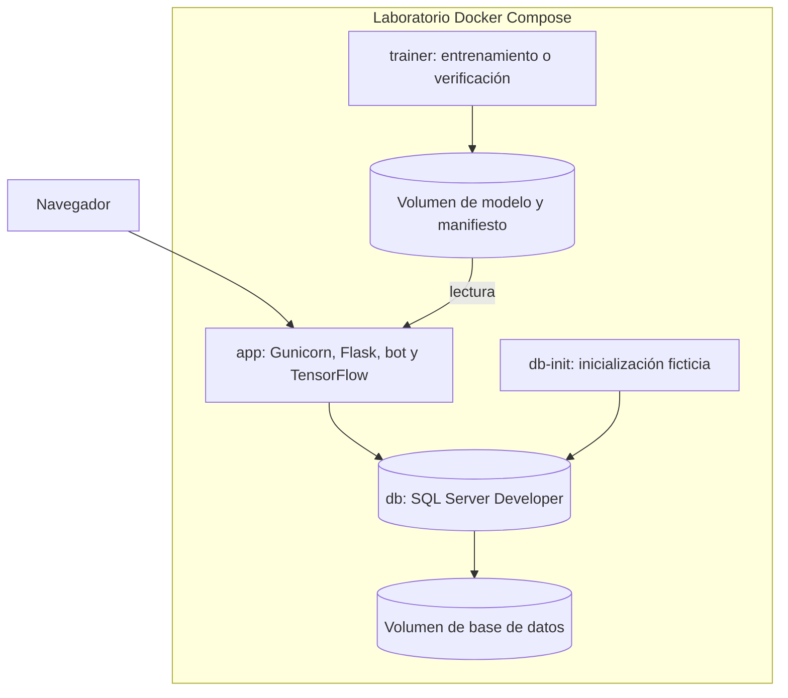

# Arquitectura y operación

La versión presentada combina una interfaz Flask con clasificación de intenciones, extracción de entidades y consultas SQL. El proyecto académico es de 2025; su adaptación reproducible local se preparó en noviembre de 2026.

## Recorrido de una pregunta

1. La persona selecciona un perfil ficticio e ingresa una pregunta en la interfaz.
2. Flask conserva el perfil en una sesión de demostración y valida la petición.
3. El texto se normaliza para el clasificador. Las reglas explícitas priorizan algunas consultas reconocibles; el diagnóstico distingue esa ruta del modelo.
4. El extractor identifica la materia, día, fecha, rango de fechas o facultad necesarios.
5. La lógica ejecuta consultas fijas con parámetros. El texto del usuario no se convierte en SQL libre.
6. La respuesta se arma con los registros encontrados y se muestra en el chat.

Las preguntas se procesan de forma acotada; conservar mensajes en la pantalla no implica que exista memoria conversacional general o razonamiento sobre todo el historial.

## Servicios de la adaptación local

| Servicio | Operación |
|---|---|
| app | Atiende la interfaz y API; usa un usuario SQL lector y monta el modelo en solo lectura |
| db | Conserva las tablas y registros ficticios del laboratorio |
| db-init | Inicializa el esquema y datos de ejemplo; termina, no es un servicio web permanente |
| trainer | Entrena explícitamente o verifica el modelo guardado; termina antes de iniciar la aplicación |

En reinicios se conservan base y modelo. La carga verifica el dataset, el orden de etiquetas y los hashes de los artefactos. Las credenciales y la clave de sesión pertenecen a la configuración privada y no forman parte de este caso.

## Modelo y datos

El dataset de esta versión contiene 480 frases y 18 intenciones. La arquitectura del código académico incluye Embedding64, BiLSTM64, promedio global, capas Dense128/64, Dropout y salida para las intenciones. En la preparación local se utiliza Python 3.11, TensorFlow CPU 2.20 y Keras 3.12. La arquitectura y sus parámetros describen la implementación, no el nivel de dominio individual ni una calidad de respuesta garantizada.

La base ficticia relaciona Estudiantes, Facultades, Profesores, Materias, Horarios, Evaluaciones, Eventos y Contactos. Dos perfiles pueden compartir materia; las evaluaciones personales se filtran también por estudiante. Los eventos son generales y los contactos de ejemplo se relacionan con la facultad.

## Entorno y alcance

La web y SQL se publican solo en la interfaz local del equipo. SQL Server Developer se usa para desarrollo/pruebas; no se presenta como una licencia de producción. La imagen SQL utilizada es x86-64. Un futuro despliegue en Oracle A1 ARM requiere revisar compatibilidad y diseño, además de recursos, acceso y exposición de red.

No hay una arquitectura VPS ejecutándose que acreditar en este caso. Docker mejora la reproducción del laboratorio, pero no demuestra por sí solo operación productiva, alta disponibilidad ni experiencia DevOps avanzada. El público contiene documentación y capturas; las instrucciones de ejecución y el código permanecen en la implementación privada.
